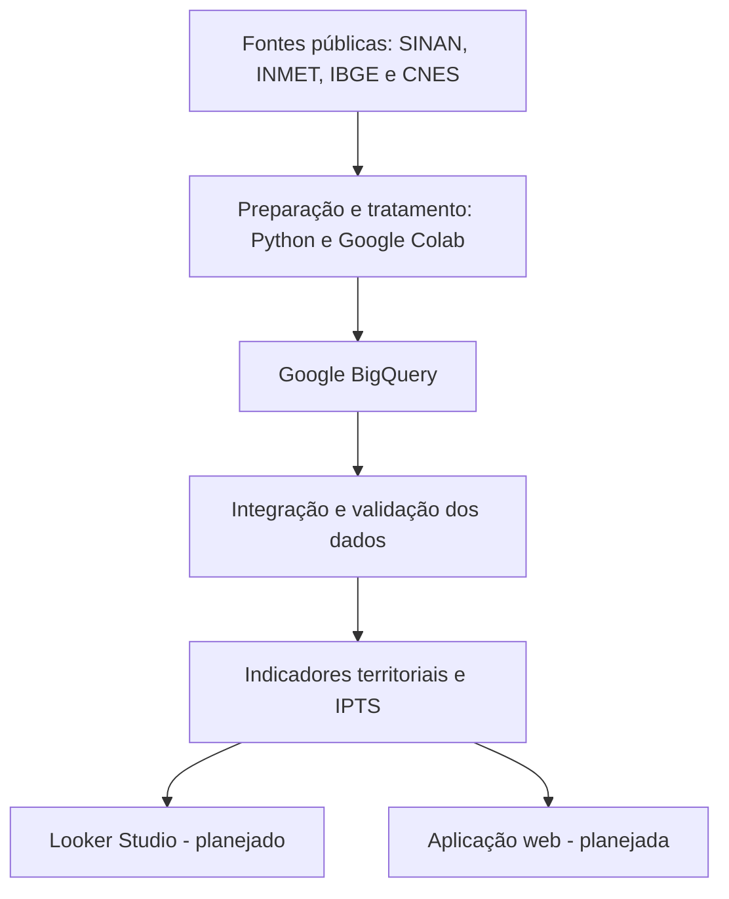

# Saúde Antes da Emergência
### Inteligência territorial para uma saúde mais justa

## Sobre o projeto

O **Saúde Antes da Emergência** é uma plataforma de inteligência territorial em saúde pública que busca apoiar gestores públicos e agentes comunitários na identificação de municípios que necessitam de maior atenção preventiva.

A proposta integra dados epidemiológicos, climáticos, populacionais e de infraestrutura de saúde para transformar informações públicas em indicadores que apoiem o planejamento de ações preventivas e de vigilância em saúde.

**Pergunta central:**

> Quais comunidades precisam de atenção preventiva primeiro, e por quê?

## Objetivo

Desenvolver uma solução de análise territorial que permita:

- Identificar padrões de notificações de doenças nos municípios brasileiros.
- Integrar informações epidemiológicas com dados populacionais.
- Incorporar informações climáticas quando houver cobertura adequada.
- Analisar a distribuição territorial dos estabelecimentos de saúde.
- Apoiar a priorização de ações preventivas com indicadores transparentes.

## Fontes de dados

| Fonte | Informações utilizadas |
|---|---|
| SINAN / DATASUS | Notificações de dengue, tuberculose, leptospirose e HIV em adultos |
| INMET | Dados meteorológicos de precipitação, temperatura e umidade |
| IBGE | Códigos municipais, população e malha territorial |
| CNES / DATASUS | Cadastro de estabelecimentos e serviços de saúde |

Os períodos de referência variam conforme a disponibilidade e o processamento de cada fonte.

## Arquitetura tecnológica

A arquitetura utiliza serviços do Google Cloud como base para armazenamento analítico, integração e consulta dos dados.



### Tecnologias

- **Python:** processamento, limpeza e preparação dos dados.
- **Google Colab:** ambiente auxiliar para processamento e experimentação.
- **Google BigQuery:** armazenamento estruturado, integração e consultas analíticas.
- **Google Cloud:** infraestrutura principal do projeto.
- **GitHub:** versionamento de código e documentação técnica.
- **Looker Studio:** ferramenta prevista para visualização dos indicadores.
- **Cloud Run:** serviço previsto para disponibilização da aplicação.

*Os componentes identificados como planejados ainda não estão implantados em produção.*

## Indicadores e análise territorial

O projeto está desenvolvendo o **Índice de Prioridade Territorial em Saúde (IPTS)**, uma proposta de indicador composto para apoiar a priorização de ações preventivas.

As dimensões consideradas são:

- Epidemiológica.
- Climática.
- Populacional.
- Infraestrutura de saúde.

A metodologia de cálculo e os pesos do índice ainda estão em validação.

As taxas epidemiológicas atualmente calculadas representam notificações selecionadas por 100 mil habitantes, utilizando a população do Censo 2022 como denominador de referência. Não devem ser interpretadas automaticamente como incidência ou probabilidade de adoecimento.

## Estrutura do repositório

```text
saude-antes-da-emergencia/
│
├── README.md
│
├── docs/
│   ├── arquitetura/
│   ├── infraestrutura/
│   ├── dados/
│   ├── governanca/
│   └── evidencias/
│
├── notebooks/
│
├── src/
│
└── .gitignore
```

## Status do desenvolvimento

**Em desenvolvimento.**

Etapas já realizadas:

- [x] Levantamento e processamento inicial de dados epidemiológicos.
- [x] Preparação de dados meteorológicos do INMET.
- [x] Integração de códigos municipais e população do IBGE.
- [x] Criação do projeto e conjunto de dados no Google BigQuery.
- [x] Criação de tabelas analíticas epidemiológicas.
- [x] Construção do painel municipal integrado.
- [x] Auditorias iniciais de cobertura e qualidade dos dados.
- [ ] Finalização da validação e integração dos dados do CNES.
- [ ] Definição metodológica do IPTS.
- [ ] Construção dos painéis de visualização.
- [ ] Desenvolvimento da aplicação web.
- [ ] Documentação técnica e governança de dados.

## Cuidados metodológicos e éticos

- Preservar valores ausentes, sem tratá-los automaticamente como zero.
- Considerar diferenças de cobertura entre fontes e municípios.
- Documentar os critérios de seleção e tratamento dos dados.
- Evitar interpretações causais sem evidências.
- Não utilizar dados territoriais para estigmatizar comunidades.
- Respeitar a LGPD e os princípios de minimização e proteção de dados.

## Finalidade

O projeto tem finalidade acadêmica e de desenvolvimento de uma solução de apoio à decisão em saúde pública. Os indicadores não substituem avaliações epidemiológicas, decisões de profissionais de saúde ou políticas públicas oficiais.
