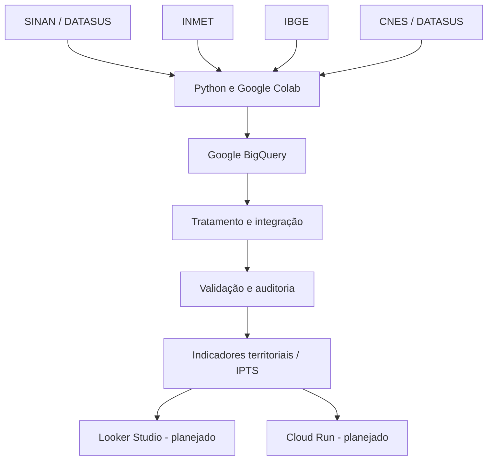

# Arquitetura Google Cloud — Saúde Antes da Emergência

## 1. Visão geral

O projeto Saúde Antes da Emergência utiliza o Google Cloud Platform (GCP) como infraestrutura principal para organização, integração e análise de dados públicos relacionados à saúde.

A arquitetura foi concebida para integrar informações epidemiológicas, climáticas, populacionais e de infraestrutura de saúde, permitindo a construção de indicadores territoriais que apoiem a prevenção e a vigilância em saúde pública.

A infraestrutura está sendo desenvolvida de forma incremental, priorizando inicialmente os recursos analíticos do Google BigQuery.

## 2. Objetivos da arquitetura

- Centralizar os dados estruturados em ambiente analítico.
- Permitir consultas e cruzamentos entre diferentes fontes públicas.
- Garantir rastreabilidade dos dados e dos processos de transformação.
- Facilitar a validação da qualidade e da cobertura das informações.
- Preparar a infraestrutura para futuras visualizações e disponibilização de uma aplicação web.
- Manter separação entre dados brutos, dados tratados e dados analíticos.

## 3. Ambiente Google Cloud

| Configuração | Valor |
|---|---|
| Plataforma | Google Cloud Platform |
| Projeto GCP | vicky-290611 |
| Serviço analítico principal | Google BigQuery |
| Dataset | saude_antes_emergencia |
| Região do dataset | southamerica-east1 |
| Localidade | São Paulo |
| Modalidade inicial | BigQuery Sandbox |

O projeto utiliza inicialmente o BigQuery Sandbox, que permite realizar consultas e trabalhar com dados analíticos sem a necessidade de configurar uma conta de faturamento.

A utilização de outros serviços do Google Cloud deverá ser avaliada conforme os requisitos técnicos e financeiros das próximas etapas.

## 4. Arquitetura lógica

O fluxo previsto para a solução é:

1. Coleta de dados em fontes públicas.
2. Preparação e padronização utilizando Python.
3. Integração e armazenamento analítico no BigQuery.
4. Validação e auditoria dos dados.
5. Construção de indicadores territoriais.
6. Disponibilização dos resultados em painéis e aplicação web.

### Diagrama da arquitetura

## 5. Serviços e responsabilidades

### 5.1 Google BigQuery

O BigQuery é o serviço central da arquitetura atual.

Responsabilidades:

- Armazenar tabelas estruturadas.
- Executar consultas SQL.
- Integrar informações de diferentes fontes.
- Realizar agregações municipais.
- Calcular taxas e indicadores.
- Apoiar auditorias de cobertura e consistência.

### 5.2 Google Colab e Python

O Google Colab é utilizado como ambiente auxiliar de processamento.

Responsabilidades:

- Leitura e conversão de arquivos públicos.
- Tratamento de arquivos SINAN e INMET.
- Padronização de códigos municipais.
- Agregação de dados.
- Preparação de arquivos para importação no BigQuery.

O Colab não é considerado a infraestrutura definitiva de produção.

### 5.3 Google Cloud Storage — planejado

Serviço previsto para armazenamento de arquivos originais e intermediários.

Sua implantação deverá considerar:

- Organização por fonte de dados.
- Separação entre dados brutos e tratados.
- Controle de acesso.
- Versionamento e retenção.
- Custos de armazenamento e transferência.

### 5.4 Looker Studio — planejado

Ferramenta prevista para construção de painéis de visualização dos indicadores territoriais.

### 5.5 Cloud Run — planejado

Serviço previsto para disponibilizar a aplicação web e seus componentes de backend, conforme a evolução do projeto.

### 5.6 Cloud Build e Artifact Registry — planejados

Serviços que poderão apoiar a automação de construção, armazenamento e implantação da aplicação.

## 6. Organização analítica no BigQuery

O dataset `saude_antes_emergencia` reúne tabelas de referência, tabelas epidemiológicas, dados climáticos, informações de infraestrutura e tabelas integradas.

Principais objetos já desenvolvidos:

| Objeto | Finalidade |
|---|---|
| municipios_validos | Cadastro de referência dos municípios |
| dengue_2025_analitica | Indicadores municipais de dengue |
| tuberculose_2025_analitica | Indicadores municipais de tuberculose |
| hiv_2024_analitica | Indicadores municipais de HIV em adultos |
| leptospirose_2024_analitica | Indicadores municipais de leptospirose |
| auditoria_codigos_nao_associados | Registro de códigos municipais não associados |
| inmet_clima_municipal_anual_staging | Estrutura municipal e anual de dados climáticos |
| painel_municipal_integrado | Integração municipal dos indicadores e dimensões disponíveis |
| cobertura_indicadores | Auditoria de cobertura epidemiológica |
| indicadores_epidemiologicos_normalizados | Indicadores normalizados por doença e ano |
| visao_indicadores_ipts | Visão analítica para apoiar o desenvolvimento do IPTS |
| cnes_municipal_staging | Agregações municipais dos estabelecimentos de saúde |
| cnes_tipo_municipal_staging | Distribuição municipal por tipo de estabelecimento |

A lista representa os objetos desenvolvidos até o momento e deverá ser atualizada conforme a evolução da infraestrutura.

## 7. Integração territorial

A integração das fontes utiliza códigos municipais do IBGE como referência.

Os dados epidemiológicos são associados aos municípios e à população de referência para o cálculo de taxas de notificações por 100 mil habitantes.

Os dados climáticos são relacionados por município e ano, evitando cruzamentos que multipliquem registros indevidamente.

Os dados do CNES são preparados para caracterizar a distribuição dos estabelecimentos e dos serviços cadastrados.

## 8. Qualidade e limitações dos dados

A arquitetura considera as seguintes limitações:

- Subnotificação e atraso de registros epidemiológicos.
- Diferenças entre os anos de referência das fontes.
- Cobertura desigual das estações meteorológicas.
- Municípios sem dados suficientes para determinados indicadores.
- Diferenças entre estabelecimentos cadastrados e capacidade efetiva de atendimento.

Valores ausentes são preservados como nulos quando não existe evidência suficiente para atribuir um valor.

As taxas calculadas são taxas de notificações selecionadas por 100 mil habitantes, utilizando população do Censo 2022 como denominador de referência. Não representam automaticamente incidência ou risco individual.

## 9. Segurança e governança

A evolução da infraestrutura deverá observar:

- Controle de acesso por função.
- Princípio do menor privilégio.
- Proteção de dados pessoais e sensíveis.
- Não publicação de credenciais ou arquivos restritos no GitHub.
- Registro dos processos de transformação.
- Documentação das regras de tratamento.
- Observância da Lei Geral de Proteção de Dados (LGPD).

O repositório público deverá conter apenas código, documentação e evidências que possam ser divulgados com segurança.

## 10. Estado atual da implementação

| Componente | Situação |
|---|---|
| Projeto Google Cloud | Criado |
| Dataset BigQuery | Criado |
| Tabelas epidemiológicas | Criadas |
| Integração municipal | Implementada |
| Estrutura climática municipal | Implementada |
| Normalização epidemiológica | Implementada |
| Integração CNES | Em validação |
| Google Cloud Storage | Planejado |
| Looker Studio | Planejado |
| Cloud Run | Planejado |
| Cloud Build | Planejado |
| Aplicação web | Planejada |

## 11. Próximas etapas

1. Finalizar a validação dos dados do CNES.
2. Consolidar as tabelas analíticas.
3. Definir e documentar a metodologia do IPTS.
4. Desenvolver os painéis de visualização.
5. Avaliar a implantação do armazenamento no Cloud Storage.
6. Desenvolver a aplicação web.
7. Implementar os processos de implantação e monitoramento.

---

**Projeto:** Saúde Antes da Emergência  
**Área:** Inteligência territorial e saúde pública  
**Infraestrutura analítica:** Google Cloud Platform / BigQuery  
**Status:** Em desenvolvimento

