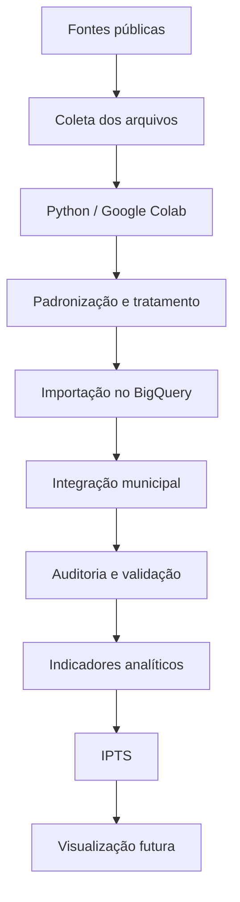

# Fluxo de Dados — Saúde Antes da Emergência

## 1. Objetivo

Este documento descreve o fluxo de coleta, preparação, integração, armazenamento e consumo dos dados utilizados no projeto Saúde Antes da Emergência.

O processo foi estruturado para permitir a integração de diferentes fontes públicas, mantendo rastreabilidade e critérios de qualidade.

## 2. Fontes de dados

| Fonte | Dados | Utilização |
|---|---|---|
| SINAN / DATASUS | Notificações epidemiológicas | Indicadores por município |
| INMET | Precipitação, temperatura e umidade | Contextualização climática |
| IBGE | Códigos municipais, população e malha territorial | Referência geográfica e populacional |
| CNES / DATASUS | Estabelecimentos de saúde | Caracterização da infraestrutura |

## 3. Etapas do processamento

### Etapa 1 — Coleta

Os arquivos são obtidos em fontes públicas oficiais, respeitando os períodos de referência e a disponibilidade de cada conjunto de dados.

### Etapa 2 — Preparação

A preparação utiliza Python e Google Colab para:

- Leitura de arquivos em diferentes formatos.
- Conversão de arquivos compactados.
- Padronização de nomes e tipos de campos.
- Tratamento de valores ausentes.
- Padronização dos códigos municipais.
- Agregação dos dados por município e período.

### Etapa 3 — Armazenamento analítico

Os dados preparados são importados para o Google BigQuery, no dataset `saude_antes_emergencia`.

### Etapa 4 — Integração

As informações são relacionadas por código municipal e, quando necessário, ano de referência.

O cruzamento entre dados climáticos e epidemiológicos considera a compatibilidade temporal, evitando associações indevidas.

### Etapa 5 — Validação

São realizadas verificações de:

- Quantidade de registros.
- Quantidade de municípios distintos.
- Duplicidades.
- Códigos municipais não associados.
- Cobertura de indicadores.
- Valores ausentes.
- Consistência entre fontes.

### Etapa 6 — Análise

Os dados integrados alimentam consultas e estruturas analíticas que apoiam a construção do Índice de Prioridade Territorial em Saúde (IPTS).

### Etapa 7 — Visualização

A disponibilização dos indicadores em painéis e aplicação web está prevista para etapas futuras.

## 4. Diagrama do fluxo

## 5. Chaves de integração

O código municipal do IBGE é utilizado como referência principal de integração territorial.

A integração observa:

- Padronização dos códigos para sete dígitos no padrão IBGE quando aplicável.
- Conversão dos códigos do SINAN para a referência municipal correspondente.
- Associação temporal entre município e ano.
- Preservação de registros sem associação validada para auditoria.

## 6. Tratamento de dados ausentes

A ausência de registros não é interpretada automaticamente como ausência de casos ou de serviços.

Valores nulos são preservados quando não existe informação suficiente para estabelecer um valor confiável.

Códigos municipais não identificados não são associados por aproximação sem validação documental.

